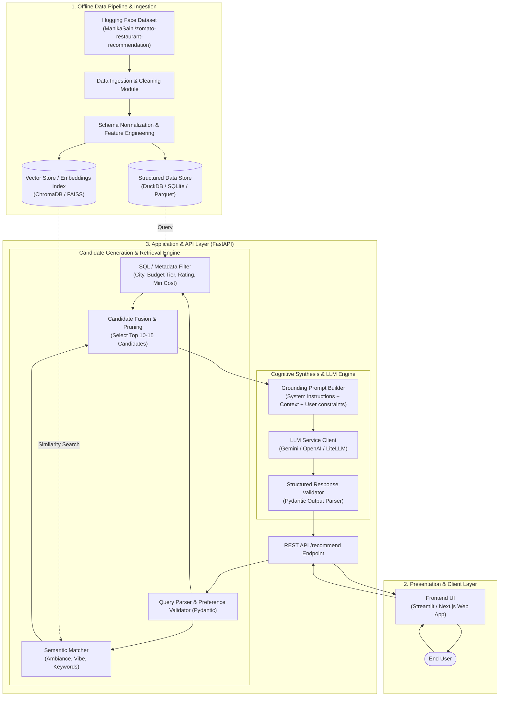
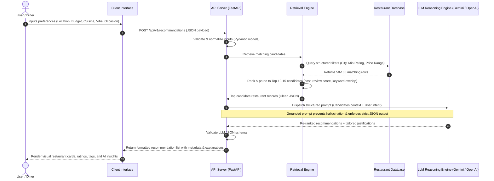

# System Architecture: AI-Powered Restaurant Recommendation System

## 1. Executive Summary & System Overview

The **AI-Powered Restaurant Recommendation System** is an intelligent dining discovery engine inspired by Zomato. It bridges traditional structured database querying with modern Generative AI / Large Language Models (LLMs) to deliver contextual, personalized, and explainable dining recommendations.

Traditional recommendation engines rely strictly on rigid categorical filtering (e.g., `City = 'Delhi' AND Cuisine = 'Italian'`), which struggles to interpret nuanced human preferences like *"cozy place with great outdoor seating for an anniversary dinner under ₹1500"*. Conversely, querying an LLM with zero grounding leads to hallucinations, outdated details, or non-existent restaurants.

This system solves this challenge via a **Hybrid Retrieval-Augmented Generation (RAG) Architecture**:
1. **Deterministic Filtering & Retrieval:** Fast pre-filtering and scoring of structured restaurant records from the Hugging Face Zomato dataset.
2. **Contextual Pruning & Ranking:** Narrowing down candidate pools to the top relevant matches based on budget, ratings, cuisine, and semantic intent.
3. **LLM Cognitive Synthesis:** Feeding strictly retrieved candidate context into an LLM to reason, re-rank, and craft human-like, persuasive justifications tailored to user preferences.

---

## 2. High-Level System Architecture



---

## 3. End-to-End Data Flow



---

## 4. Component Architecture & Modules

### 4.1 Data Ingestion & Preprocessing Layer (`src/data/`)
* **Source:** Hugging Face `ManikaSaini/zomato-restaurant-recommendation`.
* **Tasks:**
  * **Data Cleansing:** Remove duplicates, drop invalid geographic coordinates, impute missing ratings, clean currency symbols (e.g., converting `"₹800 for two"` to integer `800`).
  * **Feature Engineering:**
    * Cost Categorization: Map numerical cost to discrete budget bands (`Budget: < ₹400`, `Mid-Range: ₹400 - ₹1200`, `Fine Dining: > ₹1200`).
    * Cuisine Normalization: Split comma-separated cuisines into standardized arrays (e.g., `["North Indian", "Mughlai"]`).
    * Ambiance / Keywords Extraction: Extract keywords from reviews or description tags (e.g., `rooftop`, `pet-friendly`, `live music`, `outdoor seating`).
  * **Storage Engine:** Parquet format for fast vectorized reads or embedded DuckDB/SQLite for sub-millisecond SQL filtering.

### 4.2 Candidate Retrieval & Pruning Layer (`src/retrieval/`)
Passing hundreds of raw database rows into an LLM is cost-prohibitive, introduces latency, and exceeds optimal context density. This layer prunes the search space:
1. **Deterministic Filter (Hard Constraints):**
   * Target city/locality match (e.g., `City == "Bangalore"`).
   * Minimum rating threshold (e.g., `Rating >= 3.8`).
   * Cost range alignment with user budget.
2. **Soft Relevance Scoring (Semantic / Keyword Matching):**
   * Computes relevance scores based on requested cuisines and special preferences (e.g., "romantic atmosphere", "quick bite").
   * Yields **Top 10-15 Candidate Restaurants** with full metadata (name, cost, rating, highlighted dishes, address).

### 4.3 Cognitive Recommendation Engine (`src/llm/`)
* **Grounding Principle:** The LLM is explicitly constrained to select and rank *only* from the supplied candidates. This eliminates hallucinations of closed or fabricated restaurants.
* **Prompt Architecture:**
  * **System Role:** Acts as an expert food critic, culinary concierge, and local dining guide.
  * **Input Payload:** User preferences + serialized candidate metadata.
  * **Reasoning Task:** 
    * Evaluate best fit for the user's specific context (e.g., budget balance vs. rating quality).
    * Synthesize why each venue matches the specific request (e.g., *"Recommended because it matches your craving for authentic thin-crust pizza while staying well within your ₹1000 budget"*).
  * **Output Format:** Strict JSON Schema (enforced via Instructor, Pydantic, or native Gemini/OpenAI Structured Outputs).

### 4.4 API & Integration Service (`src/api/`)
* Built with **FastAPI** for asynchronous high-throughput execution.
* Provides health checks, dataset statistics, and query recommendation endpoints.
* Validates requests and responses with robust Pydantic schemas.

### 4.5 User Interface Layer (`src/ui/`)
* **Streamlit Web Application** or **Modern Single Page Web Client**:
  * Form controls for location selection, budget slider/pills, multi-select cuisines, minimum rating rating-stars, and free-form preference search bar.
  * Modern cards showcasing:
    * Restaurant Name & Location
    * Price for Two & Value Tier
    * Aggregated Rating & Highlights
    * **"Why You'll Love This Place"** (AI generated reasoning badge)
    * Direct booking / maps reference link

---

## 5. Data Schemas & Contracts

### 5.1 User Request Contract (`UserPreferenceInput`)
```json
{
  "location": "Bangalore",
  "budget_tier": "medium",
  "max_cost_for_two": 1200,
  "cuisines": ["Italian", "Continental"],
  "min_rating": 4.0,
  "special_preferences": "Quiet place suitable for a date, outdoor seating"
}
```

### 5.2 Structured Restaurant Candidate Entity
```json
{
  "restaurant_id": "BLR_1042",
  "name": "Toscano",
  "city": "Bangalore",
  "locality": "UB City",
  "cuisines": ["Italian", "Mediterranean"],
  "cost_for_two": 1500,
  "budget_tier": "high",
  "rating": 4.4,
  "votes": 2340,
  "highlights": ["Outdoor Seating", "Wine Tasting", "Romantic Ambiance"]
}
```

### 5.3 System Output Contract (`RecommendationResponse`)
```json
{
  "recommendations": [
    {
      "restaurant_name": "Toscano",
      "locality": "UB City",
      "cuisine": "Italian, Mediterranean",
      "rating": 4.4,
      "estimated_cost_for_two": 1500,
      "ai_explanation": "Perfect match for your romantic date night request with its open-air European courtyard ambiance and acclaimed wine-pairing menu, slightly exceeding your budget but offering top-tier value for quality.",
      "match_tags": ["Romantic", "Outdoor Seating", "Authentic Italian"]
    }
  ],
  "summary": "Found 3 top Italian restaurants in Bangalore matching your date night preference. Prioritized spots with outdoor seating and solid wine lists."
}
```

---

## 6. Prompt Engineering Strategy

### 6.1 Prompt Template Layout
```text
[SYSTEM PROMPT]
You are DineWise, a premier AI dining concierge inspired by Zomato.
Your task is to analyze candidate restaurants and select the top 3-5 recommendations that best satisfy the user's explicit and implicit preferences.

CRITICAL CONSTRAINTS:
1. ONLY recommend restaurants from the PROVIDED CANDIDATES LIST. Do NOT invent venues.
2. For each recommendation, provide an engaging, empathetic explanation explaining WHY it fits their specific constraints (budget, cuisine, vibe).
3. Output MUST adhere strictly to the JSON schema.

[USER INTENT & CONSTRAINTS]
Location: {location}
Budget: {budget_tier} (Max ₹{max_cost})
Preferred Cuisines: {cuisines}
Minimum Rating: {min_rating}
Special Requests / Vibe: {special_preferences}

[FILTERED CANDIDATES DATASET]
{candidates_json}

[RESPONSE FORMAT INSTRUCTION]
Output valid JSON adhering to the RecommendationResponse schema.
```

---

## 7. Recommended Technology Stack

| Category | Technology | Rationale |
| :--- | :--- | :--- |
| **Language** | Python 3.10+ | Standard ecosystem for AI/LLMs and data science. |
| **Data Ingestion & Store** | `datasets` (HF), `pandas`, `duckdb` | Fast dataset streaming, vector operations, and rapid in-memory SQL querying. |
| **LLM Provider** | Google Gemini 1.5 / OpenAI GPT-4o / LiteLLM | High reasoning fidelity, structured output compliance, low latency. |
| **LLM Framework** | `langchain` / `instructor` / Native SDK | Schema enforcement and prompt orchestration. |
| **Backend API** | `FastAPI` + `Pydantic v2` | High performance asynchronous REST API with auto-generated OpenAPI docs. |
| **UI Presentation** | `Streamlit` / Modern HTML/JS | Rapid, interactive data visualization and demonstration interface. |
| **Testing & Quality** | `pytest`, `ruff` | Automated code validation, unit tests, and linting. |

---

## 8. Directory & File Organization

```
NextLeap_Proj/
├── Docs/
│   ├── problemStatement.md         # Original requirements & objectives
│   └── architecture.md             # System architecture & technical specs
├── data/
│   ├── raw/                        # Ingested raw dataset cache
│   └── processed/                  # Normalized parquet / DuckDB tables
├── src/
│   ├── __init__.py
│   ├── config.py                   # App config, API keys, thresholds
│   ├── data/
│   │   ├── __init__.py
│   │   ├── ingest.py               # Hugging Face dataset downloader
│   │   └── preprocessor.py         # Cleaning, normalization, feature prep
│   ├── retrieval/
│   │   ├── __init__.py
│   │   ├── store.py                # DuckDB / SQLite data access layer
│   │   └── filter_engine.py        # Candidate search & pre-ranking
│   ├── llm/
│   │   ├── __init__.py
│   │   ├── client.py               # LLM provider wrapper (Gemini/OpenAI)
│   │   ├── prompts.py              # Prompt templates & system instructions
│   │   └── schemas.py              # Pydantic input/output schemas
│   ├── api/
│   │   ├── __init__.py
│   │   └── main.py                 # FastAPI application routes
│   └── ui/
│       └── app.py                  # Streamlit frontend dashboard
├── tests/
│   ├── test_ingest.py
│   ├── test_filter.py
│   └── test_llm_parser.py
├── .env.example
├── requirements.txt
└── README.md
```

---

## 9. Non-Functional Requirements & Best Practices

1. **Hallucination Prevention:** Grounding guarantees that the LLM only operates on real restaurants present in the dataset.
2. **Latency & Token Optimization:** Pre-filtering limits candidate size to $\le 15$ items, preventing context bloat and keeping LLM round-trip time under 2 seconds.
3. **Graceful Fallbacks:** If the LLM call times out or encounters rate limits, the system falls back to returning the deterministic top-ranked database results with template explanations.
4. **Security & Secrets:** All LLM API keys (`GEMINI_API_KEY`, `OPENAI_API_KEY`) loaded strictly through `.env` and environment variables.
