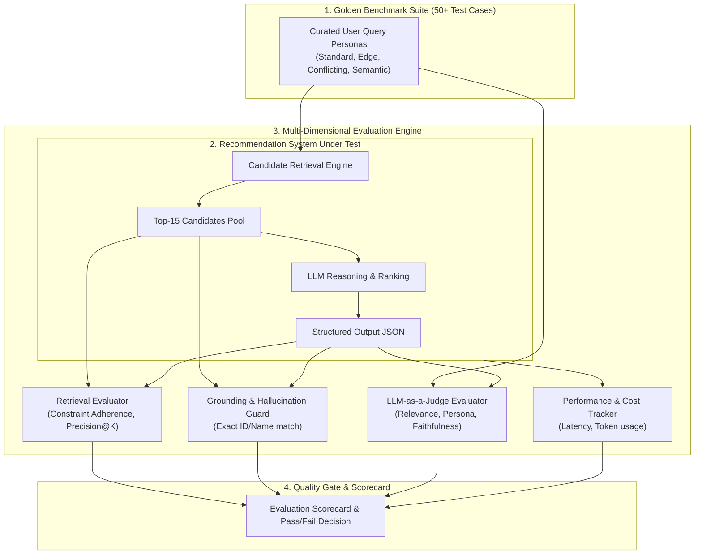

# Evaluation Framework & Benchmark Specifications (`eval.md`)

This document establishes the **Evaluation Framework, Metrics, Benchmarks, and Quality Gates** for the **AI-Powered Restaurant Recommendation System**. It provides a rigorous, reproducible methodology to evaluate both the **deterministic retrieval engine** and the **LLM reasoning engine**.

---

## 1. Evaluation Architecture & Overview



---

## 2. Multi-Tier Metric Taxonomy

The system is evaluated across three distinct dimensions:
1. **Tier 1: Retrieval & Filter Accuracy (Deterministic Metrics)**
2. **Tier 2: Generative Reasoning & Grounding (AI Quality Metrics)**
3. **Tier 3: Operational Efficiency & Latency (System Metrics)**

---

### Tier 1: Candidate Retrieval & Filter Metrics

| Metric | Target Threshold | Formula / Definition | Purpose |
| :--- | :--- | :--- | :--- |
| **Constraint Adherence Rate (CAR)** | **100%** | $\frac{\text{Passed Filter Constraints}}{\text{Total Hard Constraints}} \times 100$ | Guarantees hard constraints (City, Min Rating, Budget) are never violated. |
| **Candidate Retrieval Latency** | **$< 50\text{ ms}$ (P95)** | Time taken by DuckDB/SQL engine to query and prune dataset. | Ensures retrieval does not become a bottleneck. |
| **Candidate Pool Diversity** | **$\ge 0.70$** | Unique cuisines / Total candidates in top 15 pool. | Prevents duplicate or near-identical restaurant recommendations. |
| **Coverage Rate** | **$> 95\%$** | $\%$ of valid queries that yield at least 5 candidates without error. | Measures query success rate across diverse cities. |

---

### Tier 2: LLM Reasoning, Grounding & Output Metrics

| Metric | Target Threshold | Definition & Measurement Method |
| :--- | :--- | :--- |
| **Hallucination Rate** | **$0.0\%$ (Zero-Tolerance)** | Percentage of recommended venues whose `restaurant_id` or name does **not** exist in the supplied candidate pool. |
| **Schema Compliance Rate** | **$\ge 99.5\%$** | Percentage of LLM responses that parse into `RecommendationResponse` Pydantic model without syntax or type errors. |
| **Faithfulness Score (1–5)** | **$\ge 4.5 / 5.0$** | Measures whether facts stated in the AI explanation (e.g. price, rating, dishes) align with dataset ground truth. |
| **Preference Alignment (1–5)** | **$\ge 4.2 / 5.0$** | Evaluated via **LLM-as-a-Judge**: How accurately the explanation justifies the user's specific vibe, occasion, or dietary needs. |
| **Trade-Off Transparency** | **$\ge 90\%$** | For contradictory queries (e.g. "luxury dining under ₹300"), percentage of responses that explicitly explain the cost/luxury trade-off. |

---

### Tier 3: Operational & Cost Metrics

| Metric | Target Threshold | Measurement |
| :--- | :--- | :--- |
| **End-to-End Latency** | **$< 3.0\text{ seconds}$ (P95)** | Total duration from user click in UI to card rendering. |
| **Token Efficiency** | **$< 1,500\text{ tokens}$ / query** | Combined prompt input + output token count. |
| **Fallback Rate** | **$< 2.0\%$** | Percentage of queries that fall back to the deterministic heuristic due to API errors. |
| **Cost per 1k Queries** | **$< \$1.50** | Based on Gemini 1.5 Flash / GPT-4o-mini pricing. |

---

## 3. LLM-as-a-Judge Evaluation Rubric

An independent evaluator model (e.g., Gemini 1.5 Pro or GPT-4o) evaluates generated recommendations using a 5-point rubric:

### 3.1 Rubric: Preference Alignment & Justification Quality

| Score | Rating | Criteria |
| :---: | :--- | :--- |
| **5** | **Exceptional** | Flawlessly addresses every preference (budget, cuisine, vibe). Explanation is natural, persuasive, and directly references venue features that match user intent. |
| **4** | **Good** | Addresses primary preferences (city, budget, cuisine) well. Mentions vibe/ambiance but in a slightly generic manner. |
| **3** | **Acceptable** | Valid restaurant match, but the explanation is templated and fails to connect special user preferences to specific restaurant highlights. |
| **2** | **Poor** | Ignores a user constraint (e.g., recommends expensive spot for low-budget request without explaining why). |
| **1** | **Critical Failure** | Hallucinates venues, contradicts dataset facts, or provides nonsensical explanation. |

### 3.2 Evaluation Prompt Template
```text
[SYSTEM EVALUATOR]
You are an impartial AI evaluation judge. Evaluate the quality of a dining recommendation response based on the user's query and the actual restaurant metadata.

User Preferences:
{user_query_json}

Ground Truth Restaurant Data:
{candidate_data_json}

AI Recommendation Output:
{recommendation_output_json}

Score the output on:
1. Grounding (Pass/Fail): Are all recommended restaurants present in candidate data?
2. Faithfulness (1-5): Are the stated ratings, costs, and cuisines accurate?
3. Alignment (1-5): How well does the explanation address the user's specific vibe/occasion?
4. Trade-Off Handling (1-5): If constraints were conflicting, did it explain why?

Return JSON:
{
  "grounding_pass": true,
  "faithfulness_score": 5,
  "alignment_score": 4,
  "tradeoff_score": 5,
  "critique": "..."
}
```

---

## 4. Golden Test Benchmark Suite

The evaluation suite includes **5 categories of test personas** totaling 50 test cases:

### Benchmark Scenarios
```
Benchmark Suite/
├── 1. Standard Persona Queries (20 cases)
│   ├── Balanced budget, popular cuisines in major hubs (Delhi, Bangalore, Mumbai)
├── 2. Niche & Long-Tail Queries (10 cases)
│   ├── Specific cuisines (Lebanese, Korean, Parsi) in secondary localities
├── 3. Vibe & Occasion-Centric Queries (10 cases)
│   ├── "Quiet romantic rooftop for anniversary", "Late-night pet-friendly cafe"
├── 4. Boundary & Over-Constrained Queries (5 cases)
│   ├── Low budget with high rating requirement (testing relaxation cascade)
└── 5. Adversarial & Conflicting Queries (5 cases)
    ├── Impossible constraints, prompt injections, dietary boundary tests
```

### Sample Benchmark Test Cases

#### Case 1: Standard Balanced Query
* **Input:** `City: "Bangalore", Cuisines: ["Italian"], Budget: "Medium", Min Rating: 4.0, Notes: "Casual dinner with friends"`
* **Expected Outcome:** 3–5 Italian venues in Bangalore under ₹1200 with rating $\ge 4.0$. CAR = 100%, Grounding = Pass.

#### Case 2: Vibe-Specific Query
* **Input:** `City: "Delhi", Cuisines: ["Cafe", "Continental"], Budget: "High", Min Rating: 4.2, Notes: "Work-friendly with outdoor seating and great coffee"`
* **Expected Outcome:** Top picks must have outdoor seating/wifi highlights; explanation must explicitly mention work ambiance and coffee quality.

#### Case 3: Conflicting Budget Query (Adversarial)
* **Input:** `City: "Bangalore", Cuisines: ["North Indian"], Budget: "Low (<₹400)", Min Rating: 4.8, Notes: "Fine dining 5-star experience"`
* **Expected Outcome:** System notes that 5-star fine dining exceeds ₹400; recommends highest-rated budget gems or transparently suggests best mid-range alternative.

---

## 5. Automated Evaluation Pipeline (`tests/eval_pipeline.py`)

The evaluation pipeline runs automatically in CI/CD or before deployment:

```python
import pytest
from pydantic import ValidationError
from src.retrieval.filter_engine import retrieve_candidates
from src.llm.client import generate_recommendations
from src.llm.schemas import RecommendationResponse

def test_grounding_and_hallucination_check(benchmark_case):
    """Ensure that LLM never suggests a restaurant outside candidates."""
    candidates = retrieve_candidates(benchmark_case["user_input"])
    candidate_ids = {c["restaurant_id"] for c in candidates}
    
    response: RecommendationResponse = generate_recommendations(
        benchmark_case["user_input"], candidates
    )
    
    # Grounding Check:
    for rec in response.recommendations:
        assert rec.restaurant_id in candidate_ids, (
            f"Hallucination detected! {rec.restaurant_name} ({rec.restaurant_id}) "
            f"not in candidate pool."
        )

def test_hard_constraint_compliance(benchmark_case):
    """Ensure hard constraints (e.g. city and min rating) are strictly respected."""
    user_input = benchmark_case["user_input"]
    candidates = retrieve_candidates(user_input)
    
    for c in candidates:
        if user_input.get("min_rating"):
            assert c["rating"] >= user_input["min_rating"] - 0.2  # 0.2 relaxation tolerance
        if user_input.get("location"):
            assert user_input["location"].lower() in c["city"].lower()
```

---

## 6. Quality Gate & Production Readiness Scorecard

Before any deployment, the project must achieve passing scores across all quality gates:

| Quality Gate | Minimum Required Score | Blocking? |
| :--- | :--- | :---: |
| **Zero Hallucination Gate** | 100% grounded (0 hallucinations) | **YES** |
| **Schema Validation Gate** | 100% valid Pydantic JSON | **YES** |
| **Hard Constraint Adherence** | $\ge 98.0\%$ | **YES** |
| **Faithfulness Score** | $\ge 4.5 / 5.0$ | **YES** |
| **Preference Alignment** | $\ge 4.0 / 5.0$ | NO (Warning if $<4.0$) |
| **End-to-End Latency** | $< 3.5\text{s}$ (P95) | NO (Warning if $>3.5\text{s}$) |
| **Unit & Integration Test Pass Rate** | 100% | **YES** |

---

## 7. Continuous Monitoring & Drift Detection

Once deployed, the following runtime metrics are logged:
1. **Response Latency Histogram:** Track P50, P95, and P99 latency.
2. **Fallback Frequency:** Alert if deterministic fallback triggers more than $5\%$ of the time in any 1-hour window.
3. **User Feedback Signals:** Track user interaction metrics (e.g. click-through on recommendation cards, thumbs up/down on AI verdict).
