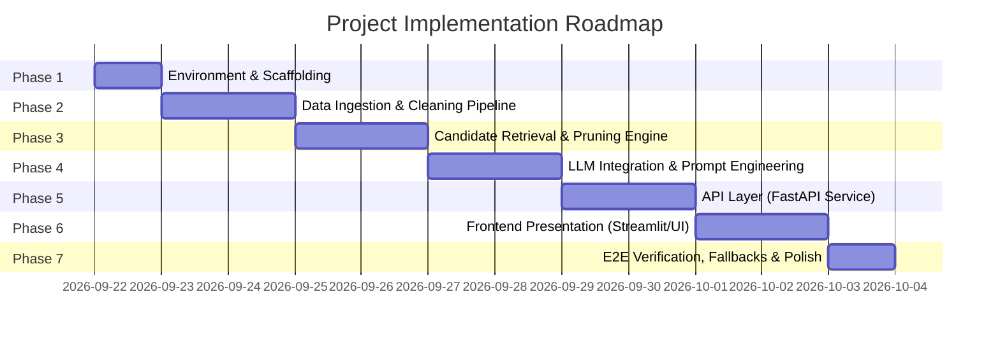

# Phase-Wise Implementation Plan: AI-Powered Restaurant Recommendation System

This implementation plan breaks down the development of the **AI-Powered Restaurant Recommendation System** into distinct, sequential, and verifiable phases based on [`architecture.md`](file:///c:/Learning%20AI/NextLeap_Proj/architecture.md) and [`problemStatement.md`](file:///c:/Learning%20AI/NextLeap_Proj/problemStatement.md).

---

## Roadmap Overview



---

## Phase 1: Environment Setup, Configuration & Project Scaffolding

### 1.1 Objectives
- Establish a clean, reproducible Python development environment.
- Configure dependency management, configuration files, and secrets handling (`.env`).
- Set up directory structure following the architectural blueprint.

### 1.2 Deliverables
- `requirements.txt`
- `.env.example` & `.env`
- `src/config.py`
- Directory skeleton (`src/data/`, `src/retrieval/`, `src/llm/`, `src/api/`, `src/ui/`, `tests/`, `data/raw/`, `data/processed/`)

### 1.3 Key Dependencies
```text
datasets>=2.19.0
pandas>=2.2.0
duckdb>=0.10.0
fastapi>=0.111.0
uvicorn>=0.30.0
pydantic>=2.7.0
streamlit>=1.35.0
google-generativeai>=0.7.0
openai>=1.30.0
python-dotenv>=1.0.0
pytest>=8.2.0
```

### 1.4 Verification & Exit Criteria
- Virtual environment created and all dependencies installed without version conflicts.
- Running `python -c "import datasets, duckdb, fastapi, streamlit; print('Ready')"` succeeds.
- Configuration module correctly reads environment variables with sensible defaults.

---

## Phase 2: Data Ingestion & Preprocessing Pipeline

### 2.1 Objectives
- Stream and ingest the Zomato restaurant dataset from Hugging Face: [`ManikaSaini/zomato-restaurant-recommendation`](https://huggingface.co/datasets/ManikaSaini/zomato-restaurant-recommendation).
- Clean raw text fields, handle missing ratings, and extract numerical cost values.
- Categorize records into standardized budget tiers and cuisine lists.
- Store the cleaned, structured data in high-performance local storage (Parquet / DuckDB).

### 2.2 Deliverables
- `src/data/ingest.py`: Script to download and cache the raw dataset.
- `src/data/preprocessor.py`: Transformation and cleaning pipeline.
- `tests/test_preprocessor.py`: Unit tests for data sanitization.
- `data/processed/restaurants.parquet` or `data/processed/zomato.duckdb`.

### 2.3 Tasks & Detailed Steps
1. **Fetch Dataset:**
   - Use Hugging Face `load_dataset("ManikaSaini/zomato-restaurant-recommendation")`.
   - Save a local checkpoint in `data/raw/`.
2. **Data Cleaning & Normalization:**
   - Parse ratings: Clean string formats (e.g., `"4.1/5"` $\to$ `4.1`, `"NEW"` / `"-"` $\to$ `NaN` or default average).
   - Parse cost: Clean `"₹800 for two"` or `"800"` $\to$ integer `800`.
   - Normalize cuisines: Convert raw strings into trimmed lowercase lists (e.g., `["north indian", "chinese"]`).
   - Clean location / city names: Standardize casing and strip whitespace.
3. **Feature Derivation:**
   - Add `budget_tier`:
     - `Low`: $< ₹400$
     - `Medium`: $₹400 - ₹1200$
     - `High`: $> ₹1200$
   - Generate searchable text blob combining name, cuisines, highlights, and city for text search.
4. **Export:**
   - Persist to `data/processed/restaurants.parquet` for fast columnar querying.

### 2.4 Verification & Exit Criteria
- Data summary script outputs valid counts (non-empty rows, $<1\%$ nulls in critical fields).
- Unit tests verify price regex and rating parsing against edge cases (`"NEW"`, `"3.5 /5"`, `None`).

---

## Phase 3: Fast Candidate Retrieval & Filter Engine

### 3.1 Objectives
- Build a sub-millisecond retrieval engine using DuckDB / Pandas to query candidate restaurants.
- Implement hard filters (Location/City, Budget Tier, Minimum Rating).
- Implement soft/semantic ranking (cuisine overlap, keyword matching for ambiance and vibe).
- Prune results to a focused candidate pool of **10–15 restaurants** to feed the LLM.

### 3.2 Deliverables
- `src/retrieval/store.py`: Database connection and table setup.
- `src/retrieval/filter_engine.py`: Structured filtering and scoring functions.
- `tests/test_filter.py`: Automated tests verifying filter constraints.

### 3.3 Tasks & Detailed Steps
1. **Query Engine Setup:**
   - Initialize DuckDB instance pointing to `restaurants.parquet`.
2. **Filter Implementation:**
   - Exact or fuzzy match on City/Locality (e.g., `LOWER(city) LIKE '%delhi%'`).
   - Rating threshold: `rating >= min_rating`.
   - Budget threshold: Match budget tier or `cost_for_two <= max_cost`.
3. **Heuristic Candidate Ranking:**
   - Calculate match score:
     $$\text{Score} = (0.4 \times \text{Normalized Rating}) + (0.4 \times \text{Cuisine Match Ratio}) + (0.2 \times \text{Vibe/Tag Match})$$
   - Sort by score descending and take the Top 15 rows.
4. **Fallback Handling:**
   - If user constraints are too strict (0 results found), progressively relax constraints (e.g., broaden budget tier or drop minimum rating by 0.5) and notify in metadata.

### 3.4 Verification & Exit Criteria
- Retrieval latency benchmark $< 50\text{ms}$ on 50,000+ restaurant records.
- Tests verify that returned candidates always respect hard city and rating boundaries.

---

## Phase 4: LLM Integration, Prompt Engineering & Schema Enforcement (Groq / openai/gpt-oss-120b)

### 4.1 Objectives
- Interface with **Groq LLM API** using the `openai/gpt-oss-120b` model (with multi-provider support for Google Gemini / OpenAI).
- Design grounded system and user prompts to eliminate hallucinations.
- Enforce strict JSON output matching Pydantic schemas using Groq's JSON mode (`response_format={"type": "json_object"}`).
- Provide tailored explanations that clearly justify why each venue matches user preferences.

### 4.2 Deliverables
- `src/llm/schemas.py`: Pydantic models for user request, candidate restaurant, and recommendation output.
- `src/llm/prompts.py`: Dynamic prompt template generator with strict candidate grounding constraints.
- `src/llm/client.py`: Groq LLM client (with `openai/gpt-oss-120b`), retry logic, schema parser, and deterministic heuristic fallback.
- `tests/test_llm.py`: Unit and integration tests for prompt formatting, schema validation, and mock/live LLM execution.

### 4.3 Tasks & Detailed Steps
1. **Define Pydantic Models:**
   - `UserPreferenceInput`: location, budget_tier, max_cost_for_two, cuisines, min_rating, special_preferences.
   - `RestaurantRecommendation`: restaurant_id, restaurant_name, locality, cuisine, rating, cost_for_two, ai_explanation, match_tags.
   - `RecommendationResponse`: list of recommendations (top 3–5 picks), summary, query_metadata, provider_used.
2. **Prompt Design & Grounding:**
   - Grounding constraints ensuring LLM only selects from provided candidate IDs/names.
   - Instruct the LLM to highlight trade-offs (e.g., "Slightly above your budget, but unmatched in authentic Italian pasta").
3. **Groq Structured Outputs & Fallbacks:**
   - Use `groq` / OpenAI-compatible API with model `openai/gpt-oss-120b` and `response_format={"type": "json_object"}`.
   - Implement deterministic fallback if API key is not configured or if network error / rate-limit occurs.

### 4.4 Verification & Exit Criteria
- Passing candidate lists to the LLM outputs 100% valid JSON conforming to `RecommendationResponse`.
- Injected test cases confirm that the LLM does not invent restaurants outside the candidate pool.

---

## Phase 5: Recommendation Service & API Layer (FastAPI)

### 5.1 Objectives
- Build a lightweight, high-performance REST API encapsulating the pipeline.
- Expose clear endpoints for recommendations, metadata inspection, and health status.
- Implement error handling, request validation, and logging.

### 5.2 Deliverables
- `src/api/main.py`: FastAPI application entry point.
- `src/api/routes.py`: API endpoints definition.
- `tests/test_api.py`: Test client integration tests.

### 5.3 API Endpoints
| Method | Route | Description |
| :--- | :--- | :--- |
| `GET` | `/health` | Service health and dataset readiness check |
| `GET` | `/api/v1/metadata/cities` | List of available cities and top cuisines |
| `POST` | `/api/v1/recommendations` | Submit preferences and receive AI recommendations |

### 5.4 Verification & Exit Criteria
- `pytest tests/test_api.py` passes using FastAPI `TestClient`.
- Interactive Swagger UI available at `http://localhost:8000/docs`.

---

## Phase 6: Frontend Presentation & User Interface

### 6.1 Objectives
- Build an interactive, visually impressive web user interface (Streamlit or modern web app).
- Provide responsive input controls (location dropdown, budget pills, multi-select cuisine tags, rating slider, natural language preference input).
- Display results as rich restaurant cards with ratings, cost badges, and dedicated AI explanation cards.

### 6.2 Deliverables
- `src/ui/app.py`: UI application code.
- Custom styling / CSS for card layouts, badges, and clean typography.

### 6.3 Features & UI Components
1. **Search & Filter Panel (Sidebar / Top Bar):**
   - City selector (populated from dataset metadata).
   - Cuisine multi-select with popular tags (Italian, North Indian, Cafe, Biryani, etc.).
   - Budget buttons: `Budget (<₹400)`, `Mid-Range (₹400-₹1200)`, `Fine Dining (>₹1200)`.
   - Minimum rating slider (1.0 to 5.0).
   - Free-form text box: *"Any specific vibe or occasion? (e.g., romantic dinner, pet-friendly, quiet place to work)"*.
2. **Results Display Grid:**
   - Header summary generated by AI.
   - Cards showcasing:
     - Restaurant name and locality.
     - Rating with star badge and vote count.
     - Price for two badge.
     - Cuisine tags.
     - **"AI Dining Verdict"**: Highlighted callout box with the personalized explanation.

### 6.4 Verification & Exit Criteria
- User can change preferences and receive updated recommendations in $< 3$ seconds.
- Clean visual hierarchy with zero broken images or unformatted JSON displayed to the user.

---

## Phase 7: End-to-End Testing, Fallback Hardening & Evaluation

### 7.1 Objectives
- Validate the full flow from user click to LLM output and card rendering.
- Harden the application against edge cases (LLM timeout, zero matches, rate limiting).
- Document setup instructions and operational guidelines in `README.md`.

### 7.2 Verification Scenarios
| ID | Scenario | Expected Behavior |
| :--- | :--- | :--- |
| **TC-01** | Standard query (e.g., Bangalore, Italian, Mid-Range) | Returns top 3-5 Italian spots in Bangalore with AI explanation matching budget. |
| **TC-02** | Highly restrictive query (e.g., Rating > 4.9 in small locality) | Gracefully relaxes constraints and returns nearest top rated spots with user notice. |
| **TC-03** | LLM API outage / rate limit | Automatically falls back to deterministic heuristic ranker with template justifications. |
| **TC-04** | Complex semantic vibe ("rooftop with live jazz") | LLM picks venues from candidates having ambiance tags matching the vibe. |

---

## Summary of Milestones & Progress Tracking

- [x] **Milestone 1:** Phase 1 complete (Repo scaffolded, virtual environment & packages confirmed).
- [x] **Milestone 2:** Phase 2 complete (Zomato dataset downloaded, cleaned, and exported to Parquet/DuckDB).
- [x] **Milestone 3:** Phase 3 complete (Candidate retrieval engine filtering data in $< 50\text{ms}$).
- [x] **Milestone 4:** Phase 4 complete (LLM prompt grounded, generating structured JSON recommendations via Groq / openai/gpt-oss-120b).
- [x] **Milestone 5:** Phase 5 complete (FastAPI endpoints serving recommendations).
- [x] **Milestone 6:** Phase 6 complete (Streamlit / Web UI fully interactive).
- [x] **Milestone 7:** Phase 7 complete (E2E tests pass, fallback mechanics hardened, demo-ready).
